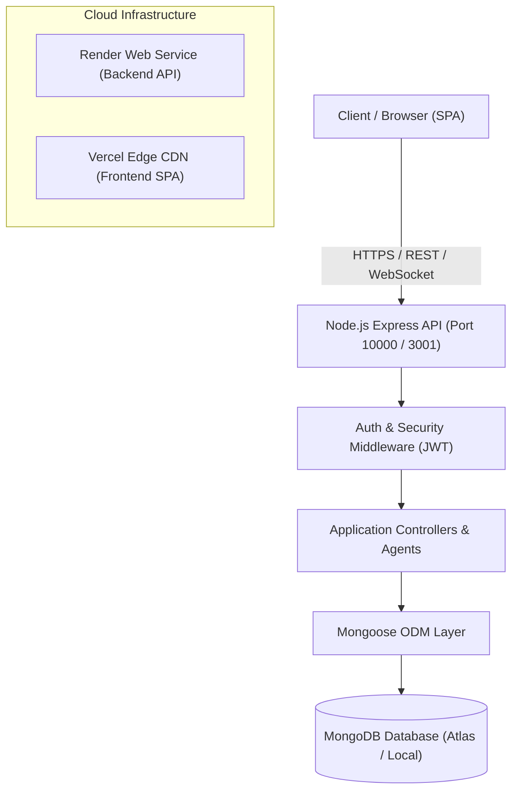

# 🚀 DUMMY-MERN-BACKEND
> The dummy-mern-backend project provides essential endpoints including a root endpoint, a health check endpoint, and a users endpoint, utilizing CORS, dotenv, Express, and Mongoose for its backend functionalities.
>
> *Maintained and verified by DevAgents Documentation Agent.*

[](https://nodejs.org/) [](LICENSE) [](docs/API_DOCUMENTATION.md) [](https://dummy-data-jecb.onrender.com) [](https://frontend-ten-eta-g9xh8fuytw.vercel.app)

## 📖 Table of Contents
1. [System Architecture](#-system-architecture)
2. [Project Folder Structure](#-project-folder-structure)
3. [Prerequisites & Dependencies](#-prerequisites--dependencies)
4. [Installation & Setup](#-installation--setup)
5. [Environment Variables](#-environment-variables)
6. [API Endpoints Overview](#-api-endpoints-overview)
7. [Database Models](#-database-models)
8. [Deployment Procedures](#-deployment-procedures)

---

## 🏛️ System Architecture


---

## 📂 Project Folder Structure
```text
backend/
├── docs/ # Technical documentation, OpenAPI specifications, and architectural blueprints
│   ├── API_DOCUMENTATION.md
│   ├── ARCHITECTURE.md
│   └── openapi.json
├── .dockerignore
├── .env
├── .env.render
├── Dockerfile
├── package.json
├── README.md
├── render.yaml
└── server.js
```

---

## 📦 Prerequisites & Dependencies
- **Node.js**: `>= 18.0.0` (Recommended: `Node.js 20 LTS`)
- **MongoDB**: `>= 6.0` (Local instance or MongoDB Atlas URI)
- **Package Manager**: `npm` or `pnpm`

**Key Production Dependencies:**
- `cors` (`^2.8.5`)
- `dotenv` (`^16.4.5`)
- `express` (`^4.19.2`)
- `mongoose` (`^8.3.4`)


---

## ⚙️ Installation & Setup
Follow these steps to run the application locally:

```bash
# 1. Clone the repository
git clone https://github.com/VanshKirtishahi/dummy-data.git
cd dummy_apps/mern-app

# 2. Install backend dependencies
cd backend
npm install

# 3. Configure environment variables
cp .env.example .env # or create .env with required keys

# 4. Start the backend service
npm start
# or for development mode:
npm run dev
```

---

## 🔑 Environment Variables
| Variable Name | Default Value | Required | Purpose & Description |
| :--- | :---: | :---: | :--- |
| **`CORS_ORIGIN`** | `https://dummy-mern-frontend.vercel.app` | ✅ Yes | Public Config (Referenced in: `.env.render`) |
| **`MONGO_URI`** | `mongodb+srv://<username>:<password>@cluster0.mongodb.net/prod_db?retryWrites=true&w=majority` | ✅ Yes | Public Config (Referenced in: `.env.render`) |
| **`NODE_ENV`** | `production` | ✅ Yes | Public Config (Referenced in: `.env.render`) |
| **`PORT`** | `5000` | ✅ Yes | Public Config (Referenced in: `.env, .env.render`) |
| **`RENDER_DEPLOY_HOOK_URL`** | `https://api.render.com/deploy/srv-dc03scjrjlhs7387d87g?key=_65ZnrCcm-E` | ✅ Yes | Public Config (Referenced in: `.env`) |
| **`RENDER_SERVICE_ID`** | `srv-dc03scjrjlhs7387d87g` | ✅ Yes | Public Config (Referenced in: `.env`) |
| **`VERCEL_TOKEN`** | `********` | ✅ Yes | 🔒 Sensitive Secret (Referenced in: `.env`) |

---

## 📡 API Endpoints Overview
A total of **3 API endpoints** were discovered in this codebase:

| Method | Path | Security | Source |
| :---: | :--- | :---: | :--- |
| 🟢 `GET` | `/` | 🔓 Public | `server.js` |
| 🟢 `GET` | `/api/health` | 🔓 Public | `server.js` |
| 🟢 `GET` | `/api/users` | 🔓 Public | `server.js` |

👉 **For the complete API reference with schemas and curl examples, see [docs/API_DOCUMENTATION.md](docs/API_DOCUMENTATION.md).**

---

## 🚀 Deployment Procedures
### 1. Backend Deployment -> Render
- Render builds and executes your service using the Dockerfile or Node.js runtime.
- **Required Port:** `PORT=10000` on `0.0.0.0`.
- **Health Check Endpoint:** `/api/health`.
- Deploy via DevAgents command: `deploy ./dummy_apps/mern-app`.

### 2. Frontend Deployment -> Vercel
- Vercel automatically deploys the Single Page Application using `vercel.json`.
- Deploy via CLI: `npx vercel --prod` or push to GitHub `main` branch.

---

*Generated by DevAgents Documentation Agent — Version 2.0*