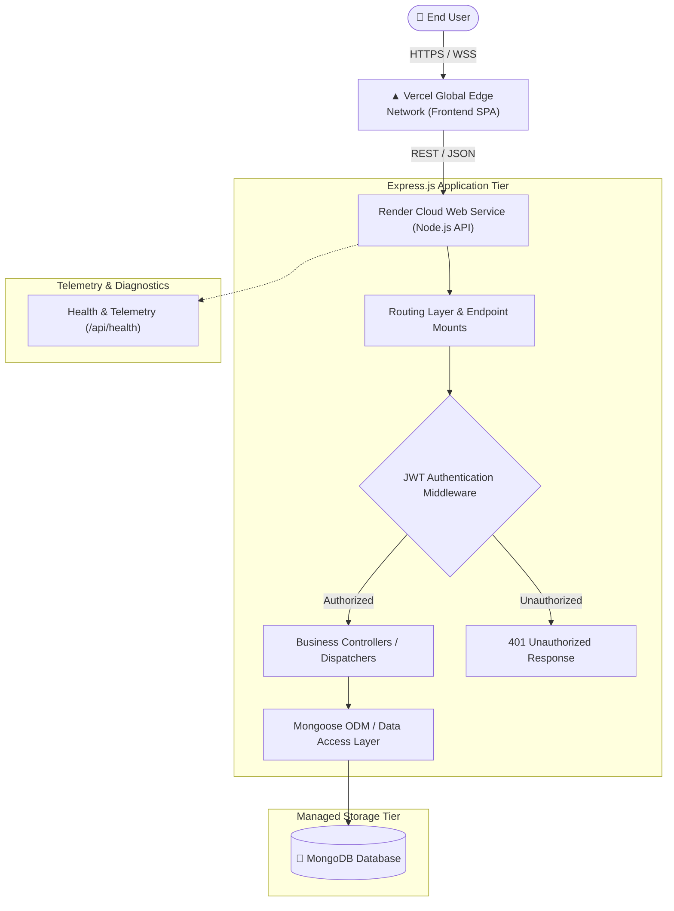
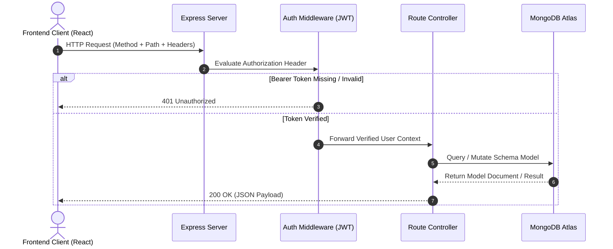

# 🏛️ Architecture & System Blueprint — dummy-mern-backend
> Comprehensive architectural documentation generated by the **DevAgents Documentation Agent**.

**Target Path:** `C:\Users\Vansh\Downloads\DevAgents\dummy_apps\mern-app\backend`  
**Generated At:** `2026-11-21T06:05:08.259Z`  

---

## 1. High-Level System Architecture
The application follows a decoupled multi-tier cloud-native architecture optimized for scale and observability:



---

## 2. Request / Response Lifecycle


---

## 3. Directory Layout & Module Responsibilities
```text
backend/
├── docs/ # Technical documentation, OpenAPI specifications, and architectural blueprints
│   ├── API_DOCUMENTATION.md
│   ├── ARCHITECTURE.md
│   └── openapi.json
├── .dockerignore
├── .env
├── .env.render
├── Dockerfile
├── package.json
├── README.md
├── render.yaml
└── server.js
```

---

## 4. Key Subsystem Metrics
- **Total Discovered API Routes:** `3`
- **Managed Database Models:** `0`
- **Target Deployment Platform:** Render (Backend Container) & Vercel (Edge SPA)